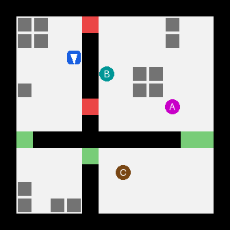
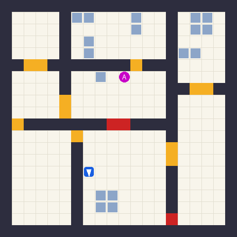
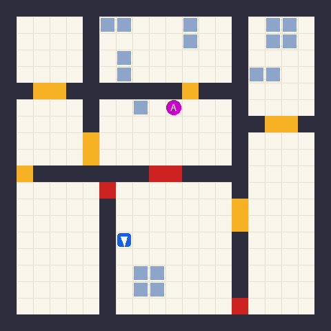
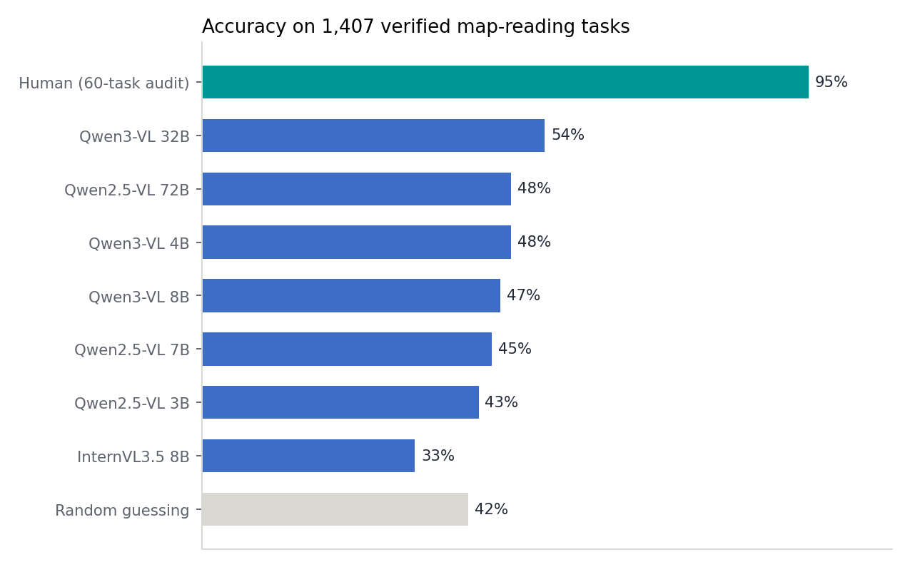
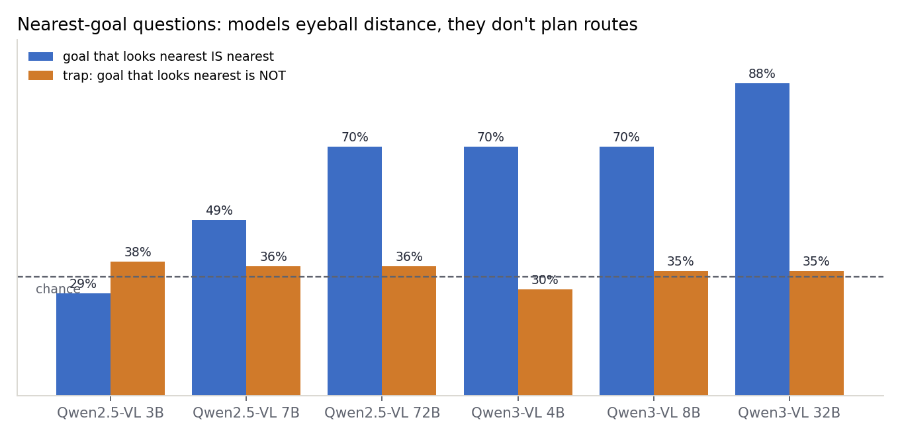

# NavProbe

**A factory of verifiable visual-reasoning tasks on robot navigation maps.**
Innodata AI Hackathon, Track 2 (Visual Task Factory).

Hospitals and warehouses are starting to use vision-language models (VLMs) as high-level planners for
service robots: the model looks at a floor map and decides where the robot can go. NavProbe measures
whether those models can actually read a map. It draws hospital floor maps, asks questions whose answers
it computes exactly (shortest paths, reachability, robot clearance, line of sight), proves that every
answer is visible in the image, and scores models against controls.

## Quick start (offline, no GPU, no API key)
```bash
pip install -r requirements.txt
make all          # tests -> generate 1,407 tasks -> verify from pixels -> oracle/random controls -> report
```
or with Docker:
```bash
docker build -t navprobe . && docker run --rm -v "$PWD/outputs:/app/outputs" navprobe
```
The same seed always produces byte-identical images and tasks (`tests/test_pipeline.py::test_deterministic`).
Checked across operating systems: running `make all` inside the Docker image (Linux) reproduced `tasks.jsonl`
and all 1,407 PNGs **byte-for-byte** identical to the macOS run (7 min 21 s end to end).

## What a task looks like
Each task is a PNG map, a question, a fixed answer format and the exact answer, plus the evidence used.

<table>
<tr>
<td align="center"><br><sub><b>Trap question.</b> Which goal is closest by driving?<br>Answer <b>C</b> (16 steps). B looks closest but is behind closed doors (29 steps).<br>6 of 7 models answered B.</sub></td>
<td align="center"><br><sub><b>Minimal pair, part 1.</b> Can the robot reach A? <b>Yes</b>.</sub></td>
<td align="center"><br><sub><b>Minimal pair, part 2.</b> Same map, one door closed: <b>No</b>.</sub></td>
</tr>
</table>

```json
{"task_id": "F5-e0008", "family": "F5_nearest_by_path", "style": "ros", "size": 14,
 "question": "Which goal is closest to the robot by DRIVING distance, not straight-line distance?",
 "answer": "C",
 "evidence": {"path_len": {"A": 23, "B": 29, "C": 16}, "straight_line_nearest": "B", "trap": true}}
```

## Results (1,407 tasks, exact-match scoring)



| Answered by | Accuracy | No image (blind) | F5: looks-nearest is nearest | F5: trap | Minimal pairs both right |
|---|---:|---:|---:|---:|---:|
| Human (60-task audit) | 95% | – | – | – | – |
| Qwen3-VL 32B (FP8) | 54% | 44% | 88% | 35% | 19% |
| Qwen2.5-VL 72B (AWQ) | 48% | 44% | 70% | 36% | 18% |
| Qwen3-VL 4B | 48% | 44% | 70% | 30% | 15% |
| Qwen3-VL 8B | 47% | 44% | 70% | 35% | 21% |
| Qwen2.5-VL 7B | 45% | 44% | 49% | 36% | 10% |
| Qwen2.5-VL 3B | 43% | 43% | 29% | 38% | 9% |
| InternVL3.5 8B | 33% | 40% | 0% | 0% | 3% |
| Random guessing | 42% | – | 30% | 40% | 24% |

Key findings:
- **A person reads these maps; models don't.** Human 95% (about 8 s per task) vs best model 54% (Qwen3-VL 32B); random guessing scores 42%.
- **Scale barely helps.** Qwen2.5-VL goes 43% → 45% → 48% from 3B to 72B (24x the parameters).
- **Bigger models eyeball better but don't plan.** On nearest-goal questions, accuracy rises to 88% when the goal that looks nearest is nearest, but stays at chance (30–36%) on traps.
- **Models ignore the evidence.** Small models score about the same with and without the image, repeat one favourite answer, and get both halves of a minimal pair right at most 21% of the time.


- InternVL3.5 8B often reasons at length and never reaches an answer within 2,048 tokens (scored as wrong; 47% on the questions it answered).

More: [full numbers (summary.json)](outputs/results/summary.json) · [all figures](outputs/results/figures/) · [failure gallery](outputs/results/gallery/gallery.md) · [human audit page](outputs/audit/audit.html) · [technical explanation](docs/TECHNICAL.md) · [limitations](docs/LIMITATIONS.md) · [verification report](outputs/verification_report.json)

## Six reasoning families
| Family | Question | Reasoning tested | Why an error matters |
|---|---|---|---|
| F1 count doors | How many open doorways lead out of the robot's room? | perception + counting, ignoring closed doors | wrong exits, so wrong routes |
| F2 left/right | Is goal A on the robot's left or right? | egocentric frame transform | the robot turns the wrong way |
| F3 reachable? | Can the robot drive to goal A? | topology / connectivity | the robot gets stuck behind a closed door |
| F4 fits? | Can a 2x2 robot get to goal A? | metric comparison of footprint vs doorway | collision in a narrow doorway |
| F5 nearest by path | Which goal is nearest by driving distance? | path planning vs straight-line heuristic | wasted trips, late deliveries |
| F6 line of sight | Is goal A visible from the robot? | geometry / occlusion | the robot assumes it can see a patient or obstacle that is hidden |

## How validity is guaranteed
1. **Answers by algorithm.** BFS, configuration-space search, ray casting. Unit-tested on hand-built maps.
2. **Pixel round-trip.** `decode.py` rebuilds the map from the PNG using only pixel colours, and the answer is
   recomputed from that. A task is kept only if both match. `make verify` re-checks the whole set.
3. **Ambiguity margins.** Near-ties are rejected (and logged with a reason): path lengths within 20%,
   goals within 30 degrees of straight ahead or behind, sight lines that graze a corner, and doorways that the robot exactly fits.
4. **Balanced answers.** Every family's base tasks are balanced across answer choices.
5. **Controls.** Oracle (reads the key) = 100%, random = chance, blind (text only, no image) ≈ chance.
6. **Human audit.** A person answered 60 random tasks (10 per family) from the image alone: 95%. All three misses were
   undercounted doorways next to wall corners; the answer key was re-checked by hand and is correct.
7. **Mutation tests.** Flipped answer keys, erased doorways, moved goals, swapped labels and flipped headings
   are all caught (`tests/test_pipeline.py`).

## Variation, beyond rewording
- Six families covering different kinds of reasoning, at four map sizes (an easy 14-cell tier, then 20, 28, 36 cells per side).
- **Minimal pairs:** the same map with one change (one door closed, heading reversed, smaller robot) that flips the answer.
- **Trap questions (F5):** in half the tasks, the goal that *looks* nearest is not the nearest by path.
- **Style twins:** the same scene in two visual styles (architectural plan and ROS occupancy grid).

## Running models
See [hpc/README.md](hpc/README.md). Backends: vLLM, transformers, Gemini API. Responses are cached per task,
so runs resume after interruption and the report can be rebuilt offline.

## Repository layout
```
navprobe/  mapgen.py  geometry.py  render.py  decode.py  families.py
           generate.py  verify.py  evaluate.py  report.py  gallery.py  audit.py
tests/     geometry, pipeline (round-trip, determinism, mutations), scoring
hpc/       Slurm script + instructions
outputs/   tasks.jsonl, images/, generation_report.json, verification_report.json,
           responses/ (cached model replies), results/ (summary, figures, gallery), audit/
```
